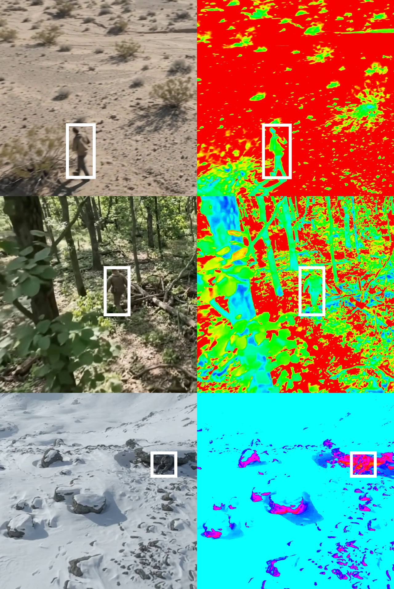
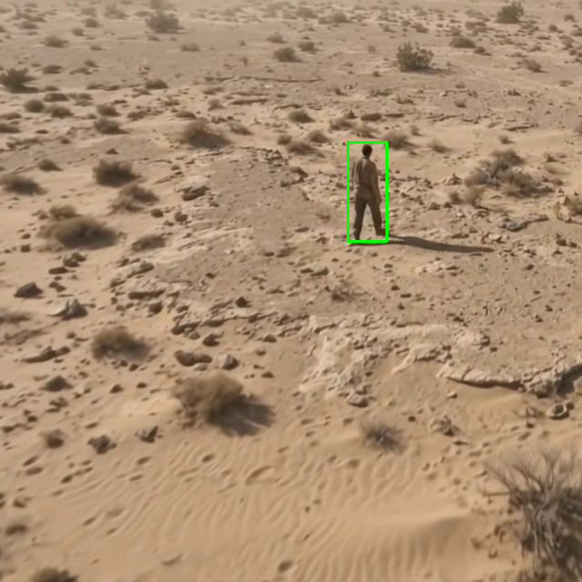
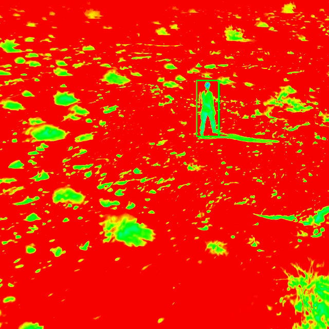
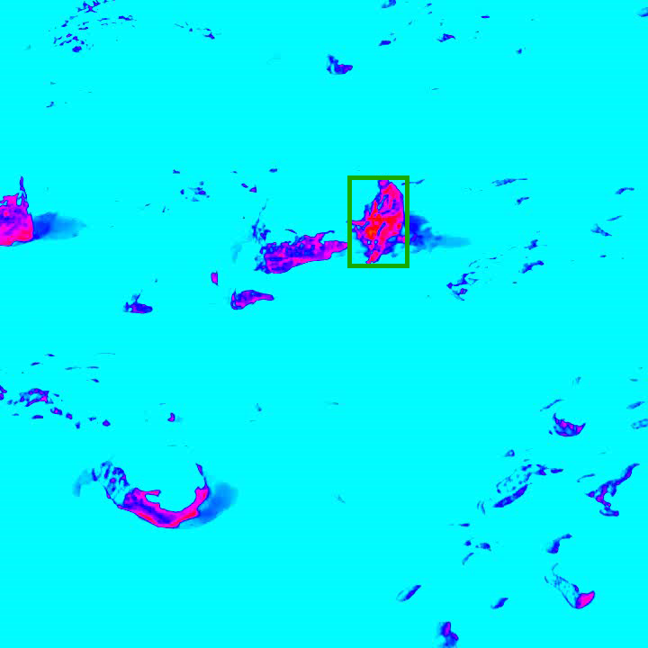

<h1 align="center">Causal Temporal Filtering for Reliable Alerts in<br>Dual-Stream UAV Search and Rescue Detection</h1>

<p align="center">
  <a href="docs/Causal%20Temporal%20Filtering.pdf"></a>
  <a href="https://icspis.com/"></a>
  <a href="LICENSE"></a>
</p>

<p align="center"><b>Oumar Mamoun Ibrahim</b> and <b>Mohamad Khairi bin Ishak</b><br>ICSPIS 2026, Dubai, UAE</p>

---

Two YOLO11n detectors (RGB + pseudo-thermal) are fused frame-by-frame; a causal filter then decides whether to raise an alert. Six filters are benchmarked on 90 clips across three biomes.

<p align="center">
  
</p>

## Results

| Method | τ\* | Tile recall | FA / min | Frame F1 | Latency |
| :--- | :---: | :---: | :---: | :---: | :---: |
| M1 raw | 0.43 | **92.3%** | 9.0 | 0.813 | **189 ms** |
| M2 moving average | 0.57 | 84.6% | **2.1** | 0.781 | 592 ms |
| M3 median | 0.49 | **92.3%** | 3.6 | 0.805 | 292 ms |
| M4 consensus | 0.49 | **92.3%** | 3.6 | 0.802 | 314 ms |
| M5 Mamba-SSSM | 0.73 | 87.7 ± 4.2% | **1.7 ± 0.6** | 0.717 ± 0.040 | 588 ms |
| M6 GRU | 0.50 | 86.2 ± 3.4% | 3.7 ± 0.3 | **0.822 ± 0.007** | 577 ms |

Late fusion (max gate) reaches frame F1 = **0.804** vs 0.768 (RGB alone) and 0.654 (thermal alone). Full tables and per-biome breakdowns are in [`runs/detect/locked_benchmark_results.json`](runs/detect/locked_benchmark_results.json).

<p align="center">
  
  
  
</p>

## Reproduce

```bash
pip install -e ".[dev]"
pytest
python scripts/evaluate_locked_thresholds.py   # reproduces the table above
```

See [`scripts/README.md`](scripts/README.md) for the full pipeline (harvest → train → evaluate).

## Citation

```bibtex
@inproceedings{ibrahim2026causal,
  title     = {Causal Temporal Filtering for Reliable Alerts in Dual-Stream UAV Search and Rescue Detection},
  author    = {Ibrahim, Oumar Mamoun and {bin Ishak}, Mohamad Khairi},
  booktitle = {Proceedings of the 9th International Conference on Signal Processing and Information Security (ICSPIS)},
  year      = {2026},
  address   = {Dubai, United Arab Emirates},
  url       = {https://github.com/IamOumarIbrahim/multi-modal-detection}
}
```

Released under the [Apache License 2.0](LICENSE).
