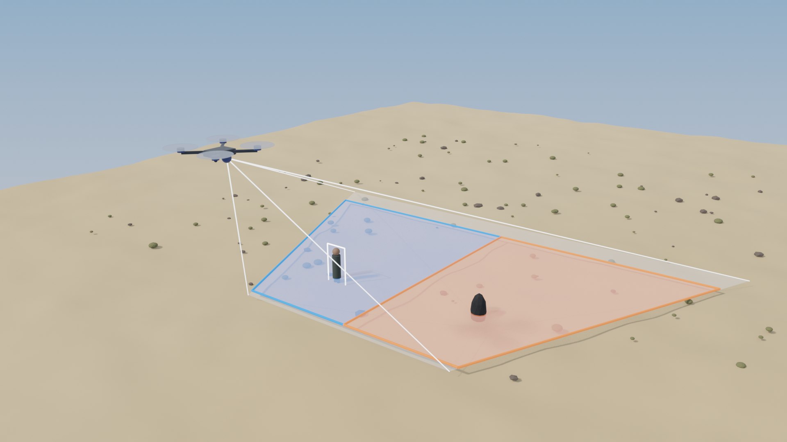
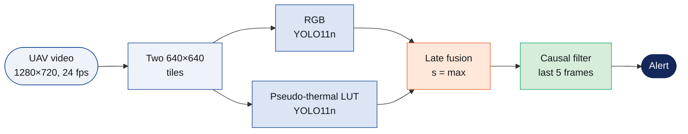
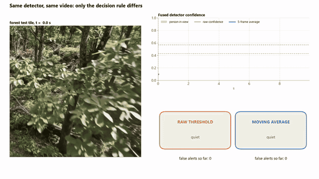
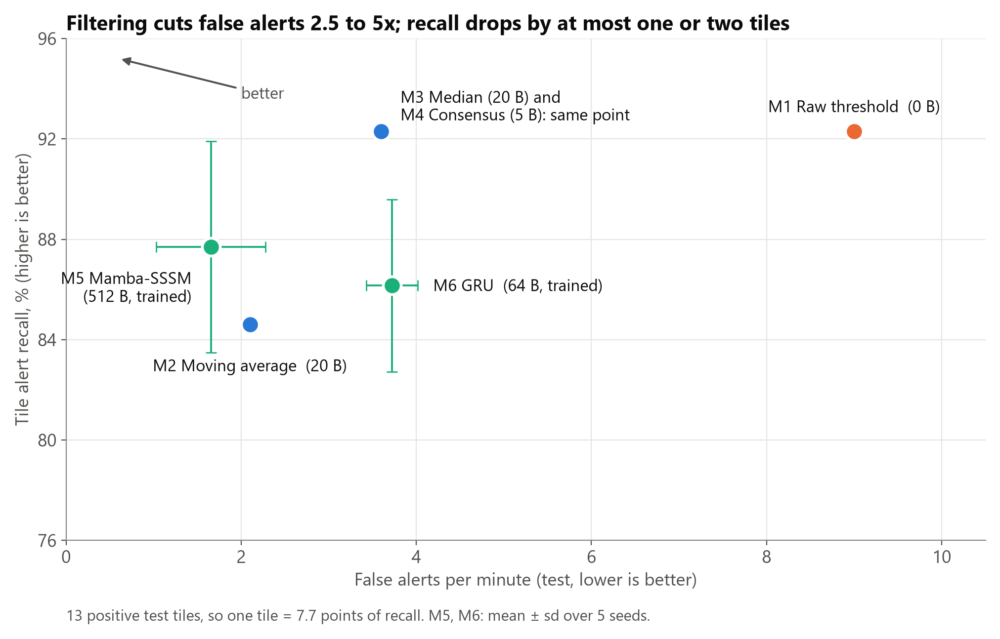
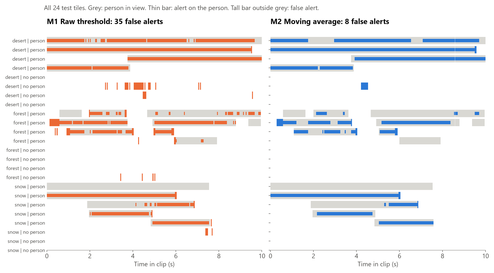
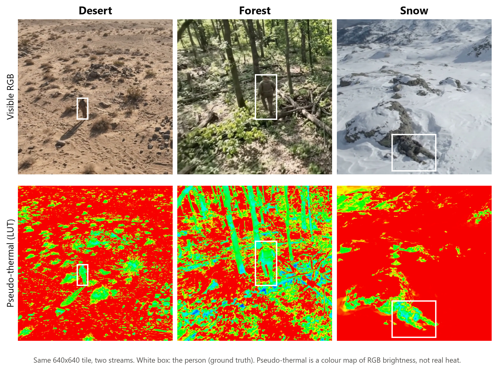

<h1 align="center">MMSAR: Causal Temporal Filtering for UAV Search-and-Rescue Alerts</h1>
<p align="center"><b>A drone's person detector flickers. Should every flicker raise an alert?</b><br>
Two YOLO11n detectors (RGB + pseudo-thermal), one fused confidence per frame, six causal filters that decide when to alert.</p>

<p align="center">
<a href="https://github.com/IamOumarIbrahim/multi-modal-detection/raw/main/manuscript/main.pdf"></a>
</p>

<p align="center">


<a href="https://icspis.com/"></a>
<a href="LICENSE"></a>
</p>



## How it works



The detectors are frozen. Only the last step changes: **M1** raw threshold, **M2** moving average,
**M3** median, **M4** 3-of-5 consensus, **M5** Mamba selective state-space model, **M6** GRU.
Every filter sees only the current and earlier frames, so it can run live on the drone.

<p align="center"></p>
<p align="center"><sub>Same detector, same test video: the raw threshold fires on every flicker, the moving average waits for the target to persist.
Full-quality videos: <a href="figures/demo_forest.mp4">forest</a>, <a href="figures/demo_desert_empty.mp4">desert, no person</a>.</sub></p>

## Results at a glance

All numbers come from `python scripts/reproduce.py` on the committed confidence cache; none are typed by hand.
Test split: 24 tiles (13 with a person), 5,570 frames, 3.87 minutes.

| Question | Answer |
|---|---|
| Does filtering cut false alerts? | Moving average: **9.0 → 2.1 per minute** (−77 %), Wilcoxon p = 0.009 over the 24 test tiles |
| What does it cost in recall? | One tile: **12/13 → 11/13**. Every classical method still finds **8 of 9** test videos |
| Best learned filter? | Mamba: **1.7 ± 0.6** false alerts/min at 87.7 ± 4.2 % recall (5 seeds). GRU: best frame F1, 0.822 ± 0.007 |
| Does fusing RGB and pseudo-thermal help? | Frame F1 **0.804** (max fusion) vs 0.768 (RGB) and 0.654 (pseudo-thermal) |
| Is it fast enough for 24 fps? | Slowest filter 150.6 µs = **0.36 %** of the 41.7 ms frame. The real cost is memory (20 B vs 512 B) and training |
| What if τ is lowered to catch faint targets? | Raw alerts jump to **22/min**; the filters stay at **8 to 10/min** |

| Method | τ\* | Tile recall | False alerts / min | Frame F1 | Alert latency |
| :--- | :---: | :---: | :---: | :---: | :---: |
| M1 raw threshold | 0.43 | **92.3 %** | 9.0 | 0.813 | **189 ms** |
| M2 moving average (W = 5) | 0.57 | 84.6 % | 2.1 | 0.781 | 592 ms |
| M3 median (W = 5) | 0.49 | **92.3 %** | 3.6 | 0.805 | 292 ms |
| M4 consensus (3 of 5) | 0.49 | **92.3 %** | 3.6 | 0.802 | 314 ms |
| M5 Mamba-SSSM | 0.73 | 87.7 ± 4.2 % | **1.7 ± 0.6** | 0.717 ± 0.040 | 588 ms |
| M6 GRU | 0.50 | 86.2 ± 3.4 % | 3.7 ± 0.3 | **0.822 ± 0.007** | 577 ms |

τ\* is one fixed threshold per method, shared by all biomes (paper Table III). They are inputs to
`scripts/evaluate_locked_thresholds.py`. `scripts/evaluate_mmsar_unified.py` runs the alternative protocol that
picks every τ\* by validation F1, and `scripts/fbeta_threshold_sensitivity.py` the recall-weighted one (Table V).

<table>
<tr>
<td width="50%"></td>
<td width="50%"></td>
</tr>
<tr>
<td><b>Recall vs false alerts.</b> Orange: raw. Blue: classical filters. Green: learned models.</td>
<td><b>Every test tile.</b> Grey: person in view. Tall bars outside grey are false alerts: 35 raw, 8 filtered.</td>
</tr>
</table>



## Install and run

```bash
git clone https://github.com/IamOumarIbrahim/multi-modal-detection.git
cd multi-modal-detection
pip install -e ".[dev,figures]"

pytest                                   # 24 unit tests (filters, metrics, labels, split, causality of M5/M6)
python scripts/evaluate_locked_thresholds.py   # paper Tables III and IV, about 1 min on CPU
```

## Reproduce the paper

```bash
python scripts/reproduce.py            # tests, Tables III to V, figures, PDF (CPU, about 4 min)
python scripts/reproduce.py --verify   # same, and fail if any committed result changes
python scripts/reproduce.py --no-pdf --no-figures   # numbers only
```

The tables need only the committed `runs/detect/unified_confidences_cache.json` (per-frame confidences of both
detectors on every split). Rebuilding the cache from video (harvest → pseudo-thermal → frames → split → train →
extract) is described in [`scripts/README.md`](scripts/README.md); it needs the raw videos and a GPU (about 3 h on an RTX 4060).

## Repository map

| Path | Contents |
|---|---|
| `src/mmsar/` | The package: `filters.py` (M1 to M4), `sequence_models.py` (M5, M6), `fusion.py`, `metrics.py`, `evaluation.py`, `labels.py` |
| `scripts/` | Pipeline steps 1 to 7, `reproduce.py`, `make_figures.py`; `talk/` holds the Blender, Manim and TikZ renders |
| `configs/` | Detector training settings and dataset files |
| `data/` | Split manifests (`splits/`), the Label Studio export (`annotations/`), video generation prompts ([`data/README.md`](data/README.md)) |
| `runs/detect/` | Confidence cache and every result JSON |
| `figures/` | README and presentation figures, demo videos |
| `manuscript/` | IEEE paper (`main.tex`, `main.pdf`), TikZ figures, `review/` for the reviewer response |
| `tests/` | `pytest` suite |

## Limits

The videos are generated (Gemini, Grok), not flown, and the pseudo-thermal stream is a colour lookup of RGB
brightness, not radiometric heat. The test split is small: 13 positive tiles, so one tile moves recall by 7.7 points.
Timings are from a desktop GPU, not an embedded board. Treat the numbers as a controlled comparison of decision
rules, not as field performance.

## Citation

```bibtex
@inproceedings{ibrahim2026causal,
  title     = {Causal Temporal Filtering for Reliable Alerts in Dual-Stream {UAV} Search and Rescue Detection},
  author    = {Ibrahim, Oumar Mamoun and bin Ishak, Mohamad Khairi},
  booktitle = {Proc. 9th International Conference on Signal Processing and Information Security (ICSPIS)},
  address   = {Dubai, United Arab Emirates},
  year      = {2026}
}
```

Apache License 2.0. YOLO11n by Ultralytics (AGPL-3.0).
